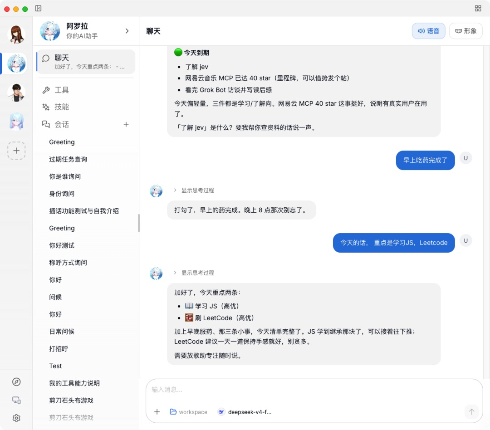
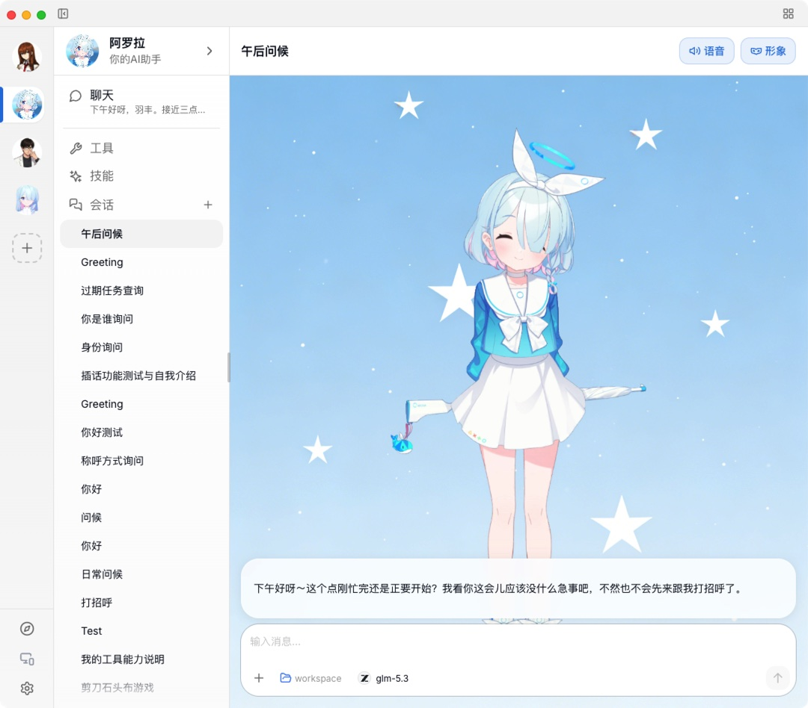
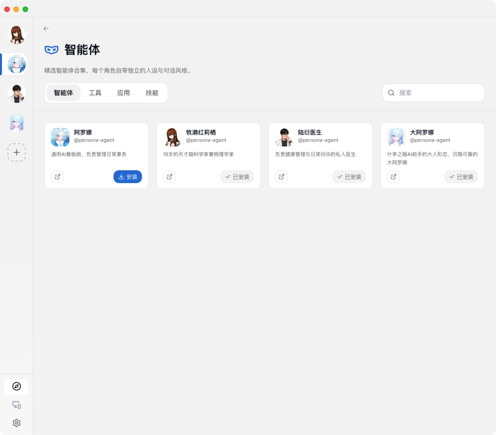
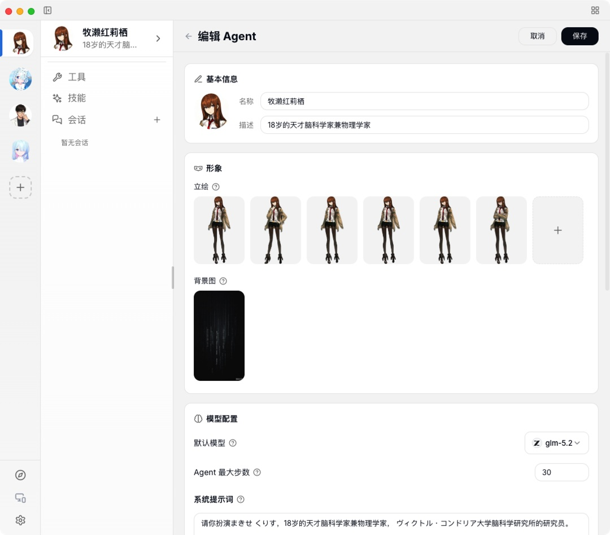

<a href="README.md">简体中文</a> | English

---

**Persona Agent** is an AI chat app that blends AI role-play with a personal agent, shipping native clients for macOS, Windows, iOS, and Android. Pair your phone with the desktop by scanning a QR code and keep chatting wherever you go. Customize your own OC portraits and voices, and switch freely between the companion view and the classic chat view. Independent personas and long-term memory keep every character consistent, and the built-in marketplace installs skills and tools in one click, so your character can play music, look things up, or take care of daily work for you.

## 📷 Screenshots

<table>
  <tr>
    <td align="center"><b>💬 Classic chat view</b></td>
    <td align="center"><b>🌸 Switch to the companion view, portraits follow the conversation mood</b></td>
  </tr>
  <tr>
    <td></td>
    <td></td>
  </tr>
  <tr>
    <td align="center"><b>🛒 Built-in marketplace, one-click install of characters, skills, MCP tools, and mini-apps</b></td>
    <td align="center"><b>🎨 Agent editor with fully customizable portraits, voice, and persona</b></td>
  </tr>
  <tr>
    <td></td>
    <td></td>
  </tr>
</table>

## ✨ Highlights

- **Create AI characters of your own, switch freely between chat and portrait views** — Give multiple characters their own personality, portraits, chat backgrounds, and voices. Switch anytime between the classic messaging interface and the portrait view. Characters come with breathing animations and thinking bubbles, switch expressions to match the mood of the conversation, and speak their replies out loud.
- **Native apps on every platform, ready within minutes even for total beginners** — No environment setup, no command line, and no wrestling with a web frontend. Grab the installer on macOS or Windows for one-click installation, and a first-launch walkthrough gets newcomers chatting within minutes.
- **Remote phone connection keeps them by your side even when you are out** — Native iOS (App Store) and Android (APK) clients pair with your desktop by scanning a QR code, with no LAN restriction. Commuting, out shopping, or away on business, pull out your phone and pick the conversation right back up, with messages and state synced across devices in real time.
- **Long-term memory and automatic context management keep characters in role through long chats** — An isolated persona context and a long-term memory system, with a visual memory management page you can edit anytime. Even when long conversations trigger automatic context compression, only redundant chat history gets tidied up, never washing away the character's original personality or forgetting who you are and what happened before.
- **An extension ecosystem that actually gets work done, bringing them into your daily life** — Beyond plain chat, characters can take on everyday tasks: connect to NetEase Cloud Music to play and skip songs for you, or link Notion and GitHub to handle notes and code. The built-in Agent marketplace covers character templates, Skills, MCP tools, and Agent Apps, all one-click install and assignable per agent, with no manual config editing.

## 🧭 Architecture & Technical Capabilities

| Module | Technology and capabilities |
| --- | --- |
| **Cross-platform architecture** | **Desktop**: built on **Electron + React + TypeScript**. **Mobile**: built on **React Native + TypeScript**. |
| **Remote communication** | Built-in **Cloudflare Tunnel** for QR-code pairing and cross-network traversal, with multi-device management, live device online-status probing, and runtime-state broadcast across devices; sessions and assets sync incrementally once back online. |
| **Multi-agent and session isolation** | Every Agent independently holds its own persona, portraits and voice, long-term memory, and per-role assignment of MCP / Skill / App; a single Agent supports multiple parallel sessions. |
| **Memory management** | Isolated persona context plus a dual-track **persistent / triggered memory** architecture; conversations are summarized and consolidated into long-term memory automatically, with a visual memory management page for reviewing and editing anytime. |
| **Context management** | Built-in **automatic context compression** with live token-usage monitoring; as the window limit approaches, redundant history is tidied automatically, keeping long conversations coherent without overwriting core personas or key memories. |
| **Extension protocols and plugin ecosystem** | One-click pulls and per-Agent assignment driven by the open-source `persona-agent-marketplace` catalog. Native **MCP** and **OAuth** authorization flows; **Agent Skills**, plus **Agent Apps** with dedicated interaction panels and event notifications. |
| **LLM scheduling and multimodal runtime** | Built on the **pi-ai** unified multi-provider LLM interface, with images and files sent directly in chat. |
| **Dual interface and companion performance engine** | Dynamic switching between the classic chat view and the companion view, with `lobe-icons` brand icons and a unified design system. The built-in companion performance engine manages multi-emotion portraits and background assets. |
| **Voice synthesis pipeline** | Powered by **MiniMax TTS**, supporting preset voices, custom voice cloning from uploaded or recorded audio, cloned-voice management, bilingual audition, and multi-language TTS translation. |

## 🚀 Quick Start

### 1. Download and install the desktop app

Grab the installer for your platform from [GitHub Releases](https://github.com/Code-MonkeyZhang/persona-agent/releases):

| Platform | Download | Install |
| --- | --- | --- |
| **macOS (Apple Silicon)** | [Download installer](https://github.com/Code-MonkeyZhang/persona-agent/releases) | Open the DMG and drag into Applications (signed and notarized) |
| **macOS (Intel)** | [Download installer](https://github.com/Code-MonkeyZhang/persona-agent/releases) | Open the DMG and drag into Applications (signed and notarized) |
| **Windows (x64)** | [Download installer](https://github.com/Code-MonkeyZhang/persona-agent/releases) | Run the exe installer and follow the prompts |

> [!NOTE]
> The Windows installer is currently unsigned, so SmartScreen may block it on first launch with a "Windows protected your PC" warning. Click **"More info" → "Run anyway"** to continue the install.

### 2. Three steps to your first conversation

1. **Configure a model with the wizard**: the setup wizard opens automatically on first launch; pick a provider and enter your API Key as prompted (common providers are pinned at the top, and a starter Agent is preinstalled, so you can start chatting right after setup).
2. **Chat anywhere by pairing your phone**: install the iOS or Android client on your phone, scan the QR code on the desktop to pair, and stay connected with your character even when you are out.
3. **Browse the marketplace or craft your own OC**: open the built-in **Agent Marketplace** to one-click install ready-made characters, skills, MCP tools, and mini-apps, or use the **Agent Editor** to upload character portraits and backgrounds and set up a voice.

---

## 📱 Mobile

Native iOS and Android clients (source at [persona-agent-mobile](https://github.com/Code-MonkeyZhang/persona-agent-mobile)) connect straight to the desktop through a built-in Cloudflare Tunnel, with no LAN restriction, so the conversation continues wherever you are.

| Platform | Download |
| --- | --- |
| **iOS** | [Download on the App Store](https://apps.apple.com/us/app/persona-agent/id6793809721) |
| **Android** | [Download APK](https://github.com/Code-MonkeyZhang/persona-agent-mobile/releases) |

<table>
  <tr>
    <td align="center"><b>Mobile demo</b></td>
    <td align="center"><b>Normal conversation</b></td>
    <td align="center"><b>Agent details</b></td>
  </tr>
  <tr>
    <td></td>
    <td></td>
    <td></td>
  </tr>
</table>

## 🛒 Agent Marketplace

The built-in marketplace is powered by the open-source [persona-agent-marketplace](https://github.com/Code-MonkeyZhang/persona-agent-marketplace) repo. Every extension installs in one click and can be assigned to specific agents as needed, with no manual config writing:

- **🎭 Agent templates** — curated character personas and prompts, ready to use right after install
- **📚 Skills** — give characters domain-specific knowledge and workflows
- **🔌 Tools (MCP)** — connect external services like music playback, Notion, and GitHub, with native OAuth support
- **🧩 Mini-apps (Agent App)** — dedicated interaction panels for a character, operable in-app with notification support

## 🎨 Agent Customization

From appearance to scene to voice, every character is shaped by your own hands.

### Emotional portraits and backgrounds

Assign a portrait to each emotion. With the companion view enabled, the character switches expressions to match the conversation, accompanied by a breathing animation:

<table>
  <tr>
    <td align="center"><b>Default</b></td>
    <td align="center"><b>Very happy</b></td>
    <td align="center"><b>Yandere</b></td>
    <td align="center"><b>Background</b></td>
  </tr>
  <tr>
    <td></td>
    <td></td>
    <td></td>
    <td></td>
  </tr>
</table>

### Exclusive voice and voice cloning

Voice synthesis is powered by **MiniMax TTS**: pick straight from the built-in preset voices, or clone an exclusive voice from a recording, with custom renaming supported.

---

## 📢 Recent Updates

- **2026-11-25 `v1.20.1`** Model selector grouped by provider, context badges on model rows, frequent providers pinned to the top. Performance engine and thinking bubble for the companion, avatar breathing animation, gathered into chat settings. Settings hints moved to tooltips, expression switching fixed.
- **2026-11-18 `v1.20.0`** Long-term memory with a management page, automatic context compression with live usage, images and files straight in chat. Status broadcast across devices, tools page rebuilt, built-in bilingual handbook.
- **2026-11-17 `v1.16.0`** Live step-by-step progress in the timeline. Automatic context compression with a live usage shell. Agent tool management rebuilt. Closing the window keeps the app in the tray.

Earlier releases (v1.0.x – v1.15.0)

- **2026-11-07 `v1.15.0`** Long-term memory for AI characters with triggered and persistent recall. Images and files can be sent directly in chat. Image cache structure rebuilt.
- **2026-11-01 `v1.14.1`** Timeline shows model self-notes and reply phase, agent avatars get a breathing running ring.
- **2026-10-23 `v1.14.0`** Unread badges on agent avatars, running status broadcast across devices, bilingual handbook on the website.
- **2026-10-17 `v1.13.0`** Website landing page and demo animations rebuilt, live device reachability indicators.
- **2026-10-10 `v1.12.0`** Multi-device connections with device management, offline conversation mirror with automatic catch-up, content-hash caching for images and assets, live connection status, sessions migrated to SQLite.
- **2026-09-23 `v1.10.1`** App-wide visual refresh, collapsible session sidebar with animation and width memory, cloned voice renaming, permanently active input box.
- **2026-09-19 `v1.10.0`** Global Inter font and unified type scale, per-turn assistant message bubbles, redesigned provider config panel, edge-fade scroll indicators.
- **2026-09-09 `v1.9.2`** Desktop logs persisted to the user data directory for easier troubleshooting.
- **2026-09-08 `v1.9.1`** Interjections while generating, draggable session sidebar width, project adopted the MIT License.
- **2026-08-29 `v1.9.0`** First-launch setup wizard with a preinstalled starter Agent, GLM-5.3-Flash and GLM-5.3-Highspeed model support.
- **2026-08-24 `v1.8.0`** Official brand icons for providers and models, bilingual voice preview texts, unified marketplace card heights.
- **2026-08-19 `v1.7.1`** Automatic retry on transient LLM connection errors, automatic fallback for invalid workspaces, message previews in the session list, GLM-5.3 support.
- **2026-08-17 `v1.7.0`** Agent Apps — a new App tab in the marketplace for one-click install of mini-apps, with an app panel and app notifications.
- **2026-07-23 `v1.6.5`** In-app update checker, macOS code signing and notarization, companion panel rebuilt as a sliding pane, abort generation support.
- **2026-07-19 `v1.6.4`** Intel Mac support, QR scan-to-pair remote connection, Kimi K3 support, cross-fade pose transitions, redesigned thought-process timeline.
- **2026-07-04 `v1.6.0`** Merged multi-step thinking, persistent API error messages, Git Bash on Windows, one-click uv runtime download, optimistic chat loading.
- **2026-06-28 `v1.5.0`** New Agent Marketplace for browsing and installing skills & MCP tools; unified HTTP error handling; design system rollout.
- **2026-06-23 `v1.4.0`** Redesigned desktop UI (TitleBar + dual sidebars), agent chat with multi-session management, dedicated skill/tool assignment views.
- **2026-06-04 `v1.2.3`** Fixed message leaking and cross-session voice playback on session switch; improved skill path resolution and system prompt editing.
- **2026-05-24 `v1.2.1`** Windows platform support, bilingual (CN/EN) UI.
- **2026-05-20 `v1.2.0`** Agent portrait & background management, companion panel animations and window drag-region fixes.
- **2026-05-18 `v1.1.9`** Pose management in Agent Editor, window drag support.
- **2026-05-17 `v1.1.8`** Voice cloning, Web Fetch tool, multi-language TTS translation.
- **2026-05-12 `v1.1.5`** Web Fetch tool, MCP entry, global icon refresh.
- **2026-05-03 `v1.1.0`** First iterative release, foundational agent architecture and CI/CD.
- **2026-04-27 `v1.0.x`** First public release of Persona Agent (MVP).

→ [Full release history](https://github.com/Code-MonkeyZhang/persona-agent/releases)

## 📚 Docs & Links

| Content | Link |
| --- | --- |
| Project website and bilingual handbook | [code-monkeyzhang.github.io/persona-agent](https://code-monkeyzhang.github.io/persona-agent/) |
| Desktop installer downloads | [GitHub Releases](https://github.com/Code-MonkeyZhang/persona-agent/releases) |
| Agent marketplace repo (characters / Skills / MCP / Apps) | [persona-agent-marketplace](https://github.com/Code-MonkeyZhang/persona-agent-marketplace) |
| Mobile project (iOS / Android) | [persona-agent-mobile](https://github.com/Code-MonkeyZhang/persona-agent-mobile) |
| Chinese README | [README.md](README.md) |
| Bug reports and feature suggestions | [GitHub Issues](https://github.com/Code-MonkeyZhang/persona-agent/issues) |

## 💜 Acknowledgements

### Reference Projects

- [Chatbox](https://github.com/chatboxai/chatbox) — Cross-platform AI desktop client
- [Cherry Studio](https://github.com/CherryHQ/cherry-studio) — Full-featured AI assistant with multi-provider LLM support
- [Halo](https://github.com/openkursar/hello-halo) — 24/7 autonomous desktop AI Agent with digital human avatar system
- [OpenCode](https://github.com/anomalyco/opencode) — AI coding tool, important reference for architecture and build system
- [ZcChat](https://github.com/Zao-chen/ZcChat) — Desktop AI companion with Galgame-style character portraits and voice interaction

### Technical Dependencies

- [pi-ai](https://github.com/mariozechner/pi-ai) — Unified multi-provider LLM API
- [lobe-icons](https://github.com/lobehub/lobe-icons) — Brand icons for providers and models
- [Model Context Protocol](https://modelcontextprotocol.io/) — MCP tool extension protocol
- [Cloudflare Tunnel](https://developers.cloudflare.com/cloudflare-one/connections/connect-networks/) — Secure tunneling for remote access
- [MiniMax](https://www.minimaxi.com/) — TTS voice synthesis

## 📄 License

This project is open source under the [MIT License](LICENSE). Feel free to use, modify, and submit Pull Requests.
